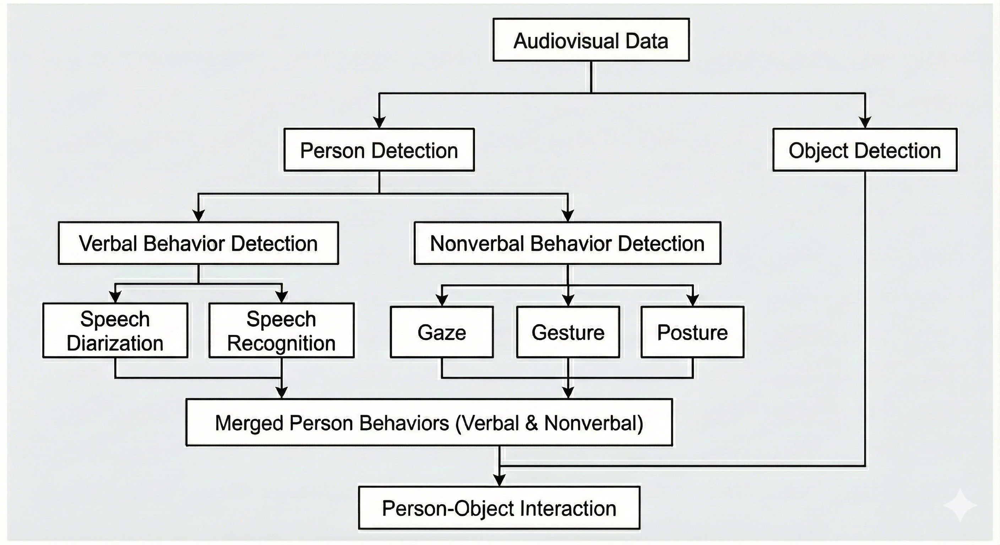
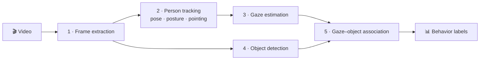
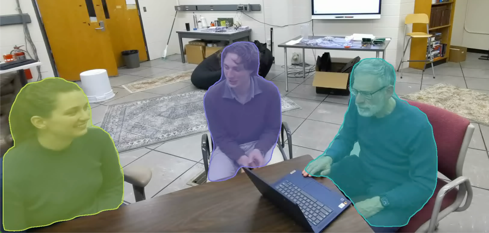
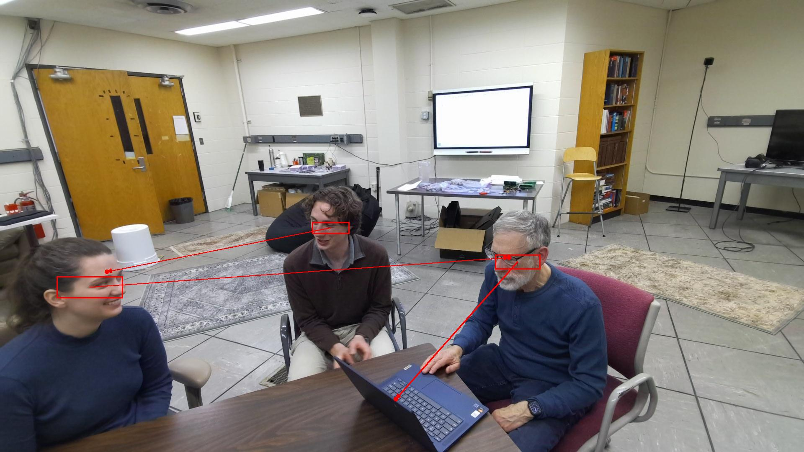
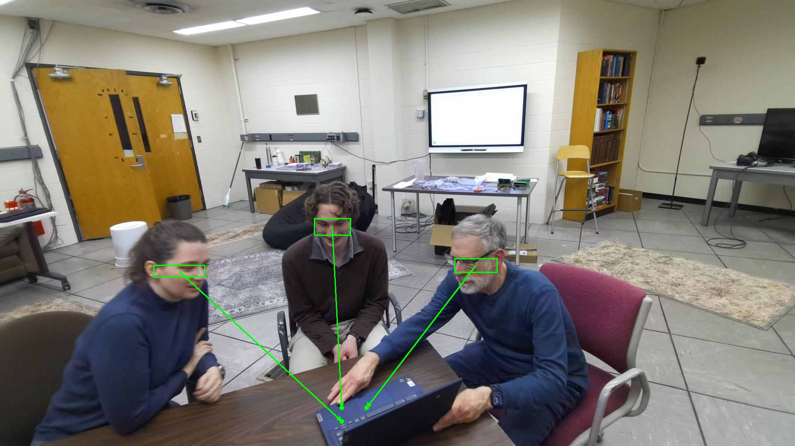
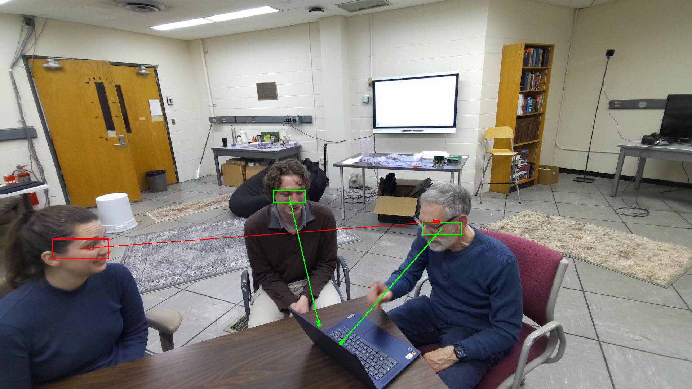
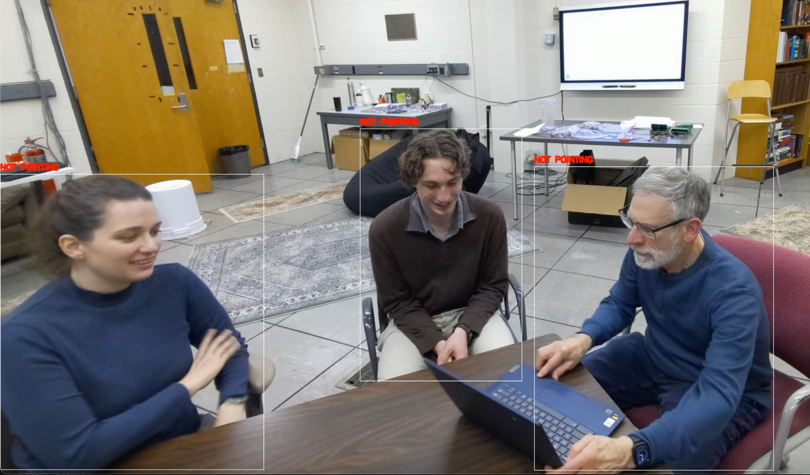
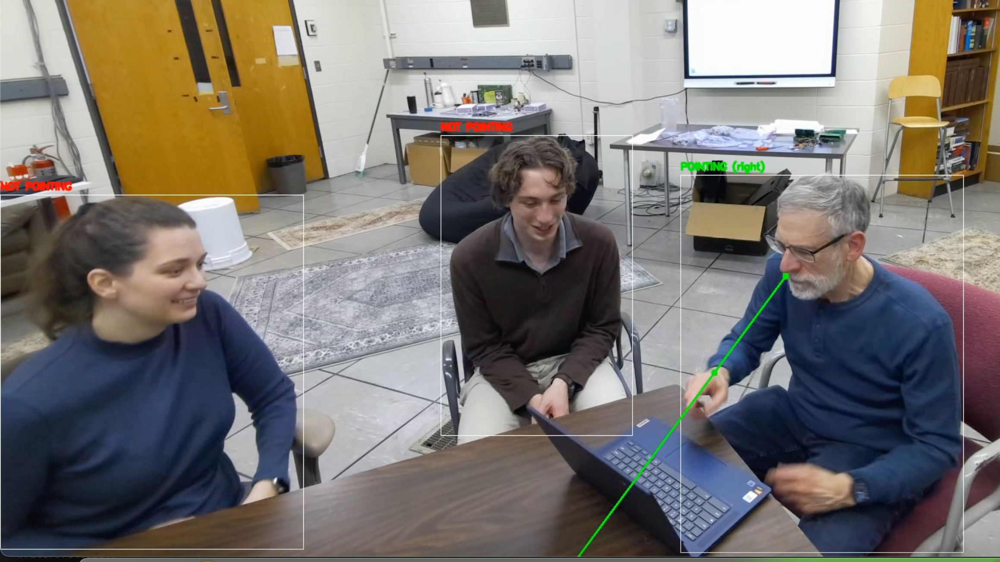
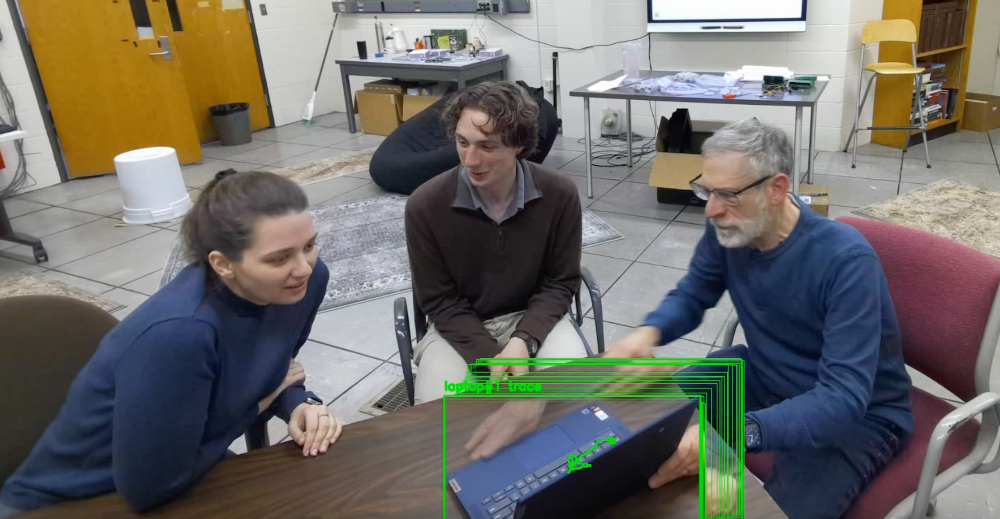

<div align="center">

# 👀 Nonverbal Behavior Recognition from RGB Video

**A five-stage perception pipeline that detects gaze, posture and pointing in multiparty collaboration, from a single camera.**




</div>

---

## ✨ At a glance

| | |
| :-- | :-- |
| 🎯 **NICE overall** | accuracy **0.73** · F1 **0.59** over 12 expert-annotated clips |
| 🏆 **Best behavior** | *Look away*: accuracy 0.96 · F1 0.82 |
| 👁️ **vs. Tobii eye tracking** | mean F1 **72.7%** (individual) · **68.4%** (group), 12 sessions |
| ⚠️ **Key limitation** | specificity **0.118**: facing the screen ≠ looking at it |

## 🔧 How it works



| Stage | Model and setting |
| --- | --- |
| Person detection | Detectron2 Keypoint R-CNN R50-FPN 3x (COCO), score ≥ 0.5, first frame only |
| Tracking | TransT, one tracker per person |
| Pose | MMPose RTMPose-m (SimCC), 256×192, 17 COCO keypoints |
| Gaze | Gaze-LLE `gazelle_dinov2_vitl14_inout`; head box from keypoints 0–4 |
| Objects | MMDetection RTMDet-L (COCO), laptop class, score ≥ 0.3 |
| Speech (not in this code) | pyannote, Whisper, TalkNet |

## 🖼️ What the pipeline sees

<table>
  <tr>
    <td colspan="3" align="center"><br><sub><b>Person detection:</b> three individuals, each segmented</sub></td>
  </tr>
  <tr>
    <td align="center" width="33%"></td>
    <td align="center" width="33%"></td>
    <td align="center" width="33%"></td>
  </tr>
  <tr><td colspan="3" align="center"><sub><b>Gaze estimation</b> in three scenarios</sub></td></tr>
  <tr>
    <td align="center"><br><sub>(a) No pointing</sub></td>
    <td align="center"><br><sub>(b) Pointing detected</sub></td>
    <td align="center"><br><sub>Laptop rotated toward the group</sub></td>
  </tr>
</table>

## 📊 Results

### Against expert NICE annotations


Movement-based behaviors (looking away, pointing, leaning away) are recognized reliably; gaze *targets* (joint and individual gaze) are the hardest. Setup and error analysis: [`results/nice/`](results/nice/).

### Against Tobii eye tracking


Head direction almost always says "screen": people shift their eyes while their head keeps facing forward. Details: [`results/tobii/`](results/tobii/).

<details>
<summary>Regenerate the charts</summary>

```bash
python results/make_charts.py               # writes figures/charts/*.svg (stdlib only)
python results/tobii/summarize.py individual_attention
```
</details>

## 🚀 Quick start

```bash
cd code
pip install -r requirements.txt --no-binary mmcv --no-build-isolation
./scripts/download_weights.sh
python server.py
```

Weights and third-party repos (TransT, Detectron2, Gaze-LLE, MMDetection) are not included. See [`code/README.md`](code/README.md) for Docker and GPU setup.

## 📁 Repository layout

| Folder | What's inside |
| --- | --- |
| [`code/`](code/) | The five-stage pipeline (`multimodal-attention-analyzer`) |
| [`figures/`](figures/) | Chapter figures 0.1–0.5 at full resolution, plus generated result charts |
| [`results/nice/`](results/nice/) | Per-behavior accuracy and F1 vs. expert NICE annotations |
| [`results/tobii/`](results/tobii/) | Head-based gaze vs. Tobii eye tracking, 12 sessions |
| [`papers/`](papers/) | The chapter and the AAAI 2025 paper, plus [`PAPERS.md`](papers/PAPERS.md) |

## 📚 Papers

- **Zhu, Y., Dey, I., Lai, K., & Pustejovsky, J. (to appear).** *Nonverbal Behavior Recognition in Multimodal Interactions from RGB Video.* Book chapter. [PDF](papers/Zhu_Dey_Lai_Pustejovsky_Nonverbal_Behavior_Recognition_RGB_Video_chapter.pdf)
- **Palmer, D., Zhu, Y., et al. (2025).** *Speech Is Not Enough: Interpreting Nonverbal Behavior in Multiparty Dialogue.* AAAI 2025. [PDF](papers/Palmer_Zhu_et_al_2025_Speech_Is_Not_Enough_AAAI.pdf)

More related work in [`papers/PAPERS.md`](papers/PAPERS.md).

## 🔒 Privacy

The figures come from the chapter as prepared for publication. Raw study recordings are IRB-protected and are not included. Check with the protocol before sharing anything here outside the lab.
